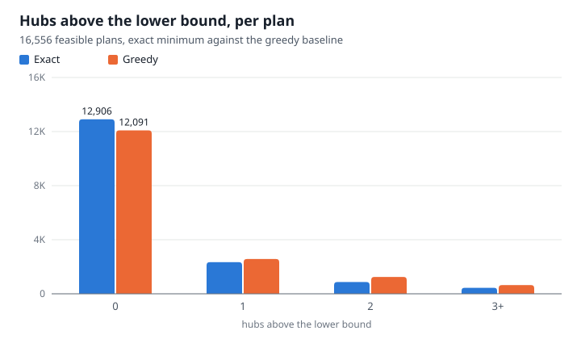
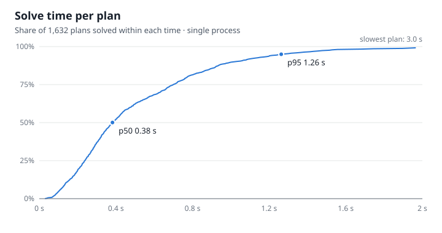

# Loopwright

Hub placement and closed-ring cable routing on residential floor plans.

Given a floor plan, Loopwright decides how many hubs, where each goes, which rooms and nodes each serves, the visiting order, and an axis-aligned cable route for every closed ring. Designs are ranked the organisers' way: fewest hubs first, then lowest cost J. Every output is re-checked by an independent validator (rules V00-V16) that rebuilds rooms, walls and doors from the raw plan and imports nothing from the solver.

## Results

Every ResPlan plan, all 17,000 (`bench/results.md`, written by `loopwright results` from the batch records in `bench/`):

- **Valid**: 16,556 of 16,556 feasible plans. The other 444 each have a room over 100 m², which no design can satisfy; they are flagged infeasible.
- **Hubs**: 29,377 against a lower bound of 23,893; the greedy baseline needs 31,046. 12,906 plans meet the bound exactly. The rest are held above it by the door rule or by rooms that don't pack into zones of at most 100 m² and 5 nodes; "Why this many hubs?" names the reason on any plan.
- **Cable**: 323,483 m in all; J = 446,668, 27.0 per plan, scored exactly as the organisers' slide 7 defines the metrics (bends at nodes and the hub, crossings and overlap inside and between rings). Nodes sit by the doors and legs keep to separate lanes, so a ring rarely runs over itself.
- **Time**: one process on a laptop, test split: p50 0.38 s, p95 1.26 s per plan.





## Setup

```bash
python -m venv .venv
.venv/Scripts/activate                               # Windows
source .venv/bin/activate                            # macOS/Linux
python -m pip install -e ".[dev,import,serve]"
python scripts/fetch_resplan.py                      # data/ResPlan.zip (~100 MB, not committed) and split.json, SHA-256 checked
python -m pytest -q
```

Extras: `import` reads DXF, images and PDFs; `serve` runs the app; `e2e` adds Playwright for the browser tests. Each download is refused unless its SHA-256 matches the pinned digest; pass `--sha256` or set `LOOPWRIGHT_RESPLAN_SHA256` to trust a different archive.

## The app

```bash
loopwright serve                                     # http://127.0.0.1:8000/
```

- **Plan by id**: any ResPlan plan, under any zone rule.
- **Upload**: a PNG, JPEG or PDF of a clean, straight-on drawing, with its scale (metres per pixel, the PDF drawing ratio, or the flat's area); or a DXF in the layer convention below. Imported room types are guesses: check them in Edit mode.
- **Draw**: drag rooms on a 0.5 m grid, tick the doors between neighbours, solve.
- **Edit**: click a door to remove it, connect two rooms, change a room's type; every change is re-solved and re-validated.
- **Cut cable**: cut any leg of a ring and see which side feeds each device.
- **Why this many hubs?** names the binding constraint and outlines the rooms that force extra hubs.
- **Installer pack**: cable schedule, bill of materials, loop resistance, cost estimate and commissioning sheet.

A link can open the app in one mode: `http://127.0.0.1:8000/#edit`, `#cut`, `#installer`, `#draw`, `#upload` or `#dxf`.

The server listens on 127.0.0.1 and refuses requests addressed to any other host unless `--allow-host` names it (`--allow-host "*"` for a public service, below).

### DXF layer convention

- `ROOMS`: one closed polyline per room, neighbouring outlines sharing their common edge, and a text label inside each naming its type (living, bedroom, kitchen, storage, bathroom, stair; "Bedroom 2", "WC" and "Lounge" are fine).
- `DOORS`: a line across the shared edge wherever two rooms connect.
- Units from the drawing's `$INSUNITS`.

## Product site

`site/` is a static site about Loopwright, drawn like an installer's working drawing: open `site/index.html` straight from disk, publish the folder on any static host, or serve it with the app (below). Its figures are isometric architectural models of solved ResPlan plans, built from the solver's own output by `loopwright/figure.py`: raised walls with the doors open and the windows glazed, rooms coloured by type and labelled with their name and area, one sun's shadows, and each ring's cable in its hub's colour. In the first, a signal runs round each ring and any leg can be cut. Every number comes from the batch records in `bench/`, and `settings.html` lists every setting with its default. `loopwright site` regenerates `site/data.js` and `site/assets/` after a new batch run. The pages, `styles.css`, `figure.css` and `main.js` are written by hand; `tests/unit/test_site_page.py` fails if a page's figures or settings drift from `site/data.js`.

`loopwright serve --site site` puts the site at `/` and the app at `/app/` as the site's playground: inside the site's own header and footer and dressed by its stylesheet, opening on a solved plan, with a model view that shows the current design as the site's scale model, with its signal and its cuts. The site then leads with "Open the playground", and its "Open in the app" buttons open that app instead of one on the visitor's machine.

## Hosting on Railway

The repository carries a `Dockerfile` and `railway.json` for one hosted service, the site in front and the app behind it.

1. In Railway, create a project from this GitHub repository. Railway builds the `Dockerfile`: it installs the package, downloads ResPlan (checked against its pinned SHA-256) and keeps the test split and the three plans the site opens (`scripts/hosted_plans.py`), about 150 MB in memory instead of 1.4 GB for all 17,000.
2. Under the service's networking settings, generate a public domain. The service answers to any host name, so the domain works as soon as Railway has made it.
3. Every push to `main` deploys again.

Railway hears about a push only through its GitHub app. If a push starts no build, install the Railway app on the GitHub account that owns the repository, with access to this repository (GitHub settings, Applications), then deploy the latest commit from Railway. Or deploy straight from a checkout with the Railway CLI: `railway login`, `railway link` to pick the project and service, then `railway up`; it uploads the checkout, leaving out what `.gitignore` names, and builds the same `Dockerfile`.

Hosted, the app solves any plan of the test split; uploads stay limited to 20 MB and plans to 12 eligible rooms, and nothing a visitor sends is stored.

## Command line

```bash
loopwright solve --id 14433 --out out/               # out/14433.json, .svg, .html (viewer), .installer.html and .installer.csv
loopwright solve --json plan.json --out out/         # an organisers' plan file instead of a ResPlan id
loopwright validate out/14433.json --id 14433        # structure, then the independent checks V00-V16
loopwright validate out/14433.json                   # structure only: types, finite numbers, schema keys
loopwright index out/                                # out/index.html listing every solved plan
loopwright batch --split test --workers 4            # a ResPlan split, failures grouped by cause
loopwright results bench/test-split.jsonl bench/val-split.jsonl bench/augmented-split.jsonl bench/train-split.jsonl   # bench/results.md
loopwright charts bench/test-split.jsonl bench/val-split.jsonl bench/augmented-split.jsonl bench/train-split.jsonl --runtime bench/latency-test.jsonl   # docs/figures/*.svg
loopwright site                                      # the product site's drawings, charts and figures (site/)
loopwright config                                    # the default settings as JSON
```

Options mirror `docs/assumptions.md`, for example `--zone-link through_rooms` or `--max-nodes 20`. A plan with more than 12 eligible rooms is refused, since the exact search walks every grouping of them (ResPlan has at most 10).

## Layout

| Path | What |
|------|------|
| `loopwright/config.py` | Every rule reading as a setting (Q1-Q14), each value checked |
| `loopwright/io/` | ResPlan loader (restricted unpickler), organisers' JSON, plan builder, plan edits, DXF, image and PDF import |
| `loopwright/geometry/` | Healing, scale, spaces, walkable area, door graph, nodes |
| `loopwright/optimize/` | Lower bound, zones, exact hub count, greedy baseline |
| `loopwright/routing/` | Axis-aligned grid router with exact bend costs |
| `loopwright/solve.py` | The pipeline, hub placement on the ring, and the repair pass |
| `loopwright/validate/` | Independent validator: structure checks, rules V00-V16, scorer (metrics as the organisers define them) |
| `loopwright/output/` | JSON (schema `loopwright/2`), SVG overlay, viewer, installer pack, cut analysis, explanations, app page |
| `loopwright/api/` | The local server behind the app |
| `loopwright/batch.py`, `results.py`, `charts.py` | Batch runs, the results table and the slide figures |
| `loopwright/site.py`, `figure.py`, `iso.py`, `site/` | The product site: scale-model figures (an isometric camera and measured painter's order in `iso.py`), charts, figures and settings, and the hand-written pages |
| `Dockerfile`, `railway.json`, `scripts/hosted_plans.py` | The hosted service: the site at `/`, the app at `/app/`, and the plans it serves |
| `bench/` | Batch records (`.jsonl`) and reports for every ResPlan split, and `results.md` |
| `docs/` | Assumptions, schema, testing playbook, demo script, phase notes, figures |

## Status

See `docs/phases/`. Each phase ends with a tag (`phase-1`, `phase-2`, ...) that is pushed and tested before the next merge.

## Credits

ResPlan dataset (Abouagour and Garyfallidis, 2025; CC BY 4.0).
